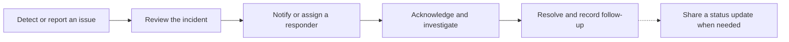
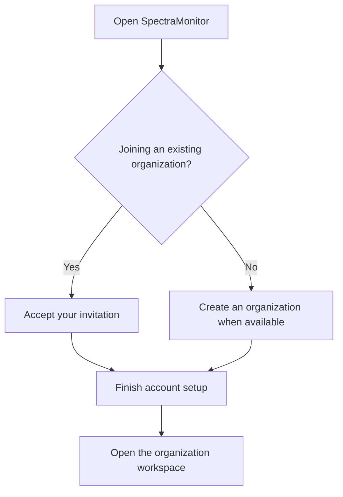

<h1 align="center">👁️‍🗨️ SpectraMonitor</h1>

<strong>Uptime Monitoring &amp; Incident Management</strong>

  <a href="https://monitor.spectraeye.app/">Open SpectraMonitor</a> ·
  <a href="#key-features">Explore features</a> ·
  <a href="#getting-started">Getting started</a>

## Overview

SpectraMonitor helps teams monitor their services, coordinate incident response, and keep customers informed. Each organization manages its own monitors, responders, notification policies, and status pages.

## Key features

| Workspace | What your team can do |
| --- | --- |
| 📡 **Monitoring** | Check availability, expected page content, service reachability, certificate expiry, browser journeys, and recurring check-ins. |
| 📈 **Reliability** | Group monitors into services, set reliability objectives, and review error budgets. |
| 🚨 **Incidents** | Assign responders, follow a timeline, acknowledge and resolve issues, and record follow-up work. |
| 📅 **On-call** | Build schedules and rotations, fill coverage gaps, and manage overrides and shift swaps. |
| 📣 **Status pages** | Publish branded status pages, announce incidents and maintenance, and let visitors subscribe to updates. |
| 🔔 **Notifications and alert sources** | Route updates to responders and connected destinations, and review your personal inbox. |
| 📊 **Reports and collaboration** | Review trends, export available reports, coordinate in chat, and keep notes and reminders. |
| 🏢 **Organization management** | Invite members, assign roles, manage organization settings, and review your subscription. |

## Contents

- [Monitoring and reliability](#monitoring-and-reliability)
- [Incident response and on-call](#incident-response-and-on-call)
- [Notifications and alert sources](#notifications-and-alert-sources)
- [Status pages and reports](#status-pages-and-reports)
- [Chat and personal workspace](#chat-and-personal-workspace)
- [Organization roles and settings](#organization-roles-and-settings)
- [Getting started](#getting-started)

## Monitoring and reliability

- **Dashboard and monitors.** Review monitor health, active incidents, and recent activity available to your role. Find monitors by group, pause or resume them, and run an on-demand check where supported.
- **Check results and maintenance.** Review individual checks, response times, and state changes. Export available checks or history as CSV or PDF. Use maintenance windows to control how your team is notified during planned work.
- **Services and reliability objectives.** Group monitors under services, assign owners, and track reliability against an objective. Use the error budget to see how much room remains for service issues.
- **Check locations and heartbeats.** Run eligible checks from a private location where available. For recurring work, set the expected check-in time and how long to wait before marking a missed check-in as down. Agent summaries can help investigate a problem.

## Incident response and on-call

- **Incidents.** Create an incident when a problem is reported, or review one created from a check or connected alert. Acknowledge it, assign a responder, add timeline updates, and notify watchers. Resolve or reopen it as needed, and record follow-up work in a postmortem.
- **On-call coverage.** Build schedules and rotations, review upcoming coverage, and fill gaps. Use overrides and shift swaps to handle changes.

## Notifications and alert sources

- **Personal inbox.** Filter updates, open the related item, or mark one or several notifications as read.
- **Notification policies.** Choose the events, responders, teams, and destinations to notify. Use a monitor-specific override for exceptions and escalate an incident if it remains unacknowledged. Available channels can include email, SMS, voice, and connected team tools.
- **Alert sources.** Review alerts from connected tools and how they relate to incidents. Preview the routing before creating a test incident, then review the source history when investigating a missed or repeated alert.

## Status pages and reports

- **Status pages.** Choose which components to display, apply your organization’s branding, and preview the page. Publish incident updates and planned maintenance for the affected components.
- **Subscriber updates.** Visitors can choose which updates to receive. Where available, preview and test newsletters before sending them to subscribers who opted in.
- **Reports.** Filter by period and the available report criteria to review uptime, incident response and resolution times, or notification activity. Choose the widgets you need and export available reports as CSV or PDF.

## Chat and personal workspace

- **Chat.** Coordinate in direct or group conversations. Use replies, mentions, reactions, attachments, and polls where available.
- **Notes.** Keep personal notes, link them to a monitor, service, or incident for context, and set reminders for follow-up.
- **Preferences.** Choose your time zone, date and time formats, and dashboard display preferences.

## Organization roles and settings

Roles and permissions determine which workspaces and actions each member can use in their organization.

| Responsibility | What it covers |
| --- | --- |
| **Organization Owner** | Manages ownership of the organization, including transfer to an eligible administrator. |
| **Organization administrator** | Manages members, teams, roles, and shared settings within their permissions. |
| **Member** | Works in the areas available to their assigned roles. |

- **Members and roles.** Invite teammates, review pending invitations, and assign built-in or custom roles. The organization Owner can initiate a transfer, and the invited administrator can accept or decline it.
- **Shared settings and activity.** Manage organization branding, default incident watchers, and weekly summaries. Authorized users can review and export organization activity or request an organization data export.
- **Subscription.** Review the organization’s plan, expiry, and grace period. The Owner and authorized delegates can see available renewal options and contact support when needed.

Feature and channel availability depends on the organization’s settings and permissions.

## Getting started

1. [Open SpectraMonitor](https://monitor.spectraeye.app/). Choose **Create Organization** when available, or use an invitation to join an existing organization.
2. Follow the email instructions and finish setting up your account. The person who creates the organization becomes its Owner.
3. Open the workspaces available to your role. If you manage the organization, invite your team and assign roles in **Organization Settings**. Start with one monitor and choose who should receive its updates.

After signing in, use the **Help Center** for searchable guides to organization workflows. Use **Contact support** for help with account access or subscription questions.

---

  <strong>Built with ❤️ by the SpectraEYE Team</strong>

