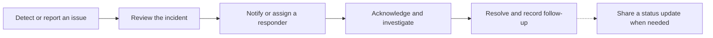
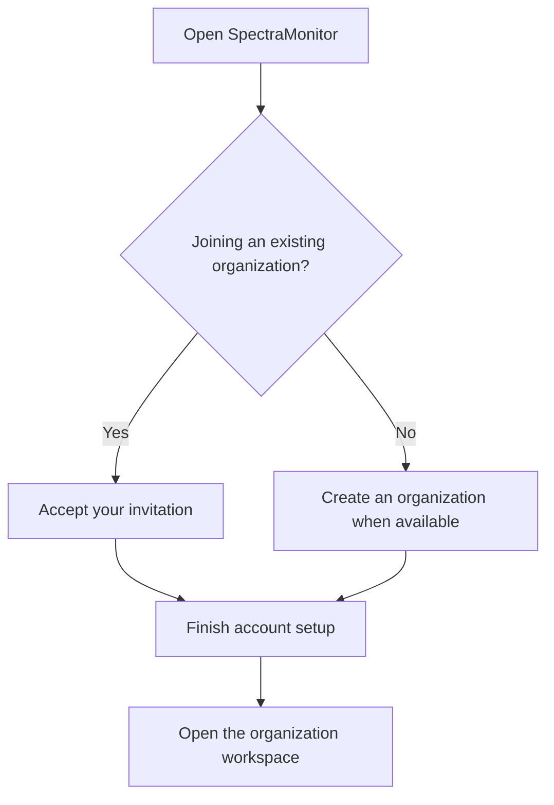

<h1 align="center">👁️‍🗨️ SpectraMonitor</h1>

<strong>Uptime Monitoring &amp; Incident Management</strong>

  <a href="https://monitor.spectraeye.app/">Open SpectraMonitor</a> ·
  <a href="#key-features">Explore features</a> ·
  <a href="#getting-started">Getting started</a>

## Overview

SpectraMonitor helps teams monitor their services, coordinate incident response, and keep customers informed. Each organization manages its own monitors, responders, notification policies, and status pages.

## Key features

| Workspace | What your team can do |
| --- | --- |
| 📡 **Monitoring** | Check availability, expected page content, service reachability, certificate expiry, browser journeys, and recurring check-ins. |
| 📈 **Reliability** | Group monitors into services, set reliability objectives, and review error budgets. |
| 🚨 **Incidents** | Assign responders, follow a timeline, acknowledge and resolve issues, and record follow-up work. |
| 📅 **On-call** | Build schedules and rotations, fill coverage gaps, and manage overrides and shift swaps. |
| 📣 **Status pages** | Publish branded status pages, announce incidents and maintenance, and let visitors subscribe to updates. |
| 📊 **Reports and collaboration** | Review trends, export available reports, coordinate in chat, and keep notes and reminders. |

## Contents

- [Monitoring and reliability](#monitoring-and-reliability)
- [Incident response and on-call](#incident-response-and-on-call)
- [Status pages and reports](#status-pages-and-reports)
- [Organization roles and settings](#organization-roles-and-settings)
- [Getting started](#getting-started)

## Monitoring and reliability

- **Monitors** can be grouped, assigned check intervals, and paused for planned maintenance. Review check history when investigating a change in behavior.
- **Services and reliability objectives** give related monitors a shared context and help teams track reliability over time.
- **Private check locations** can run eligible checks where available. Agent summaries and alert sources can provide additional context during an investigation.

## Incident response and on-call

Use incidents to track what happened, who owns the response, and how it was resolved. Add watchers and timeline updates, then record follow-up work in a postmortem when useful.

On-call schedules define who is available to respond. Notification policies can route updates to people, teams, or configured destinations and escalate unacknowledged incidents. Available channels can include email, SMS, and voice.

## Status pages and reports

- **Status pages** show selected components and let teams publish incident updates or scheduled maintenance. Visitors can subscribe to the updates they want to receive.
- **Reports** help teams review availability, incidents, and notification activity. Export available reports as CSV or PDF.
- **Chat and Notes** give members a place to coordinate responses and keep track of personal follow-ups.

## Organization roles and settings

Roles and permissions determine which workspaces and actions each member can use in their organization.

| Responsibility | What it covers |
| --- | --- |
| **Organization Owner** | Manages ownership of the organization, including transfer to an eligible administrator. |
| **Organization administrator** | Manages members, teams, roles, and shared settings within their permissions. |
| **Member** | Works in the areas available to their assigned roles. |

In **Organization Settings**, authorized users can review organization activity and manage settings. The Owner and authorized delegates can review subscription details and available renewal options. Feature and channel availability depends on the organization’s settings and permissions.

## Getting started

1. [Open SpectraMonitor](https://monitor.spectraeye.app/). Choose **Create Organization** when available, or use an invitation to join an existing organization.
2. Follow the email instructions and finish setting up your account. The person who creates the organization becomes its Owner.
3. In **Organization Settings**, invite your team and assign roles. Create your first monitor and choose who receives updates.

After signing in, use the **Help Center** for searchable guides to organization workflows. Use **Contact support** for help with account access or subscription questions.

## About this repository

This repository contains the public product overview for the hosted SpectraMonitor application.

---

  <strong>Built with ❤️ by the SpectraEYE Team</strong>

