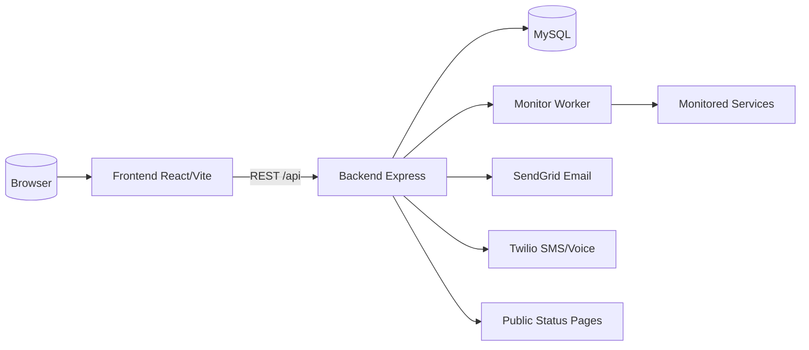
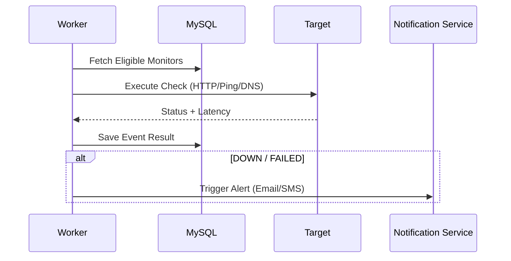
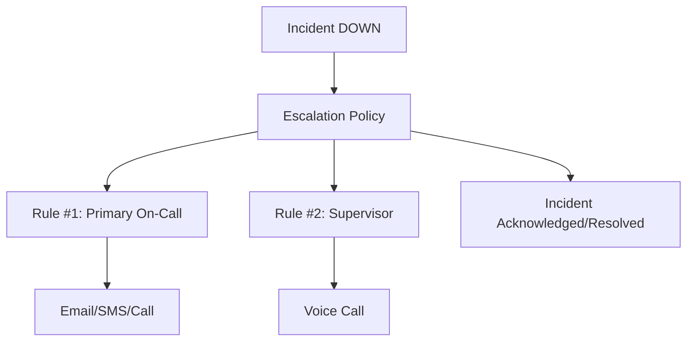

# 🛡️ SpectraMonitor - Uptime & Incident Management


> **SpectraMonitor** (SpectraEYE Lite) is a powerful SaaS platform for **uptime monitoring**, **incident management**, and **public status pages**. It enables technical teams to detect downtime instanty and communicate transparency with customers.

---

## 📑 Table of Contents

1.  [About the Project](#-about-the-project)
2.  [Key Features](#-key-features)
    *   [Service Monitoring](#service-monitoring)
    *   [Status Pages](#status-pages)
    *   [On-Call & Escalations](#on-call--escalations)
    *   [Super Admin Console](#super-admin-console)
3.  [Roles & Permissions](#-roles--permissions)
4.  [Technology Stack](#-technology-stack)
5.  [System Architecture](#-system-architecture)
    *   [System Context](#system-context)
    *   [Monitoring Flow](#monitoring-flow)
    *   [Escalation Blueprint](#escalation-blueprint)
6.  [Project Structure](#-project-structure)
7.  [Installation & Setup](#-installation--setup)
8.  [License](#-license)

---

## 🚀 About the Project

SpectraMonitor minimizes downtime impact through rapid detection and coordinated response. Designed for **DevOps teams**, **MSPs**, and **SaaS providers**, it offers:
*   Real-time detection of service failures.
*   Automated alerts via multi-channel notifications.
*   Public Status Pages to keep customers informed.
*   Operational efficiency with on-call schedules.

---

## ✨ Key Features

### Service Monitoring
*   **Diverse Checks**: HTTP, Ping, DNS, TCP/UDP, Heartbeat, and **Playwright** browser scenarios.
*   **SSL/TLS Monitoring**: Automatic alerts for expiring certificates.
*   **Configurable Frequency**: Custom check intervals and timeout settings.

### Status Pages
*   **Public Access**: Dedicated pages reachable via custom slugs.
*   **Subscriptions**: Customers can subscribe to specific components for email updates.
*   **Maintenance**: Scheduled maintenance windows displayed on the timeline.

### On-Call & Escalations
*   **Global Schedules**: Timezone-aware rotations and shift overrides.
*   **Escalation Policies**: Define rules to escalate alerts (e.g., if User A doesn't ack in 5m, notify User B).
*   **Multi-Channel**: Email, SMS, and Voice Call integrations.

### Super Admin Console
*   **Tenant Management**: Manage organizations, licenses, and trial expirations.
*   **Impersonation**: Securely impersonate organization admins for support.
*   **Global Maintenance**: Set application-wide maintenance modes.

---

## 👥 Roles & Permissions

SpectraMonitor is a **multi-tenant** system with Role-Based Access Control (RBAC):
*   **User**: Access to monitors, incidents, and status pages.
*   **Admin**: Manage organization users, settings, and billing.
*   **Super Admin**: Platform-level control (tenants, licenses, global settings).

---

## 🛠 Technology Stack

### **Frontend**
*   **Framework**: [React 18](https://reactjs.org/) + [Vite](https://vitejs.dev/) + [TypeScript](https://www.typescriptlang.org/)
*   **UI**: TailwindCSS + Shadcn/UI + Radix
*   **State**: React Query

### **Backend**
*   **Runtime**: [Node.js](https://nodejs.org/) + [Express](https://expressjs.com/)
*   **Database**: [MySQL 8.x](https://www.mysql.com/) (Multi-tenant)
*   **Auth**: JWT + Reform Tokens + MFA (TOTP)
*   **Services**: SendGrid (Email), Twilio (SMS/Voice)

---

## 🏗 System Architecture

### System Context



### Monitoring Flow
The lifecycle of a monitoring check.



### Escalation Blueprint



---

## 📂 Project Structure

```bash
SpectraMonitor/
├── src/                 # Frontend Application (UI, Pages, Hooks)
├── backend/             # Backend API & Workers
│   ├── routes/          # REST Endpoints
│   ├── workers/         # Monitoring Logic
│   └── services/        # Third-party integrations
├── public/              # Static Assets
└── export_SpectraMonitor_db.sql # Database Schema
```

---

## ⚡ Installation & Setup

### Requirements
*   Node.js 18+
*   MySQL 8.x

---

## 📄 License

Distributed under the Proprietary License. See `LICENSE` for more information.

---

<p align="center">
  **Built with ❤️ by the SpectraEYE Team**
</p>
